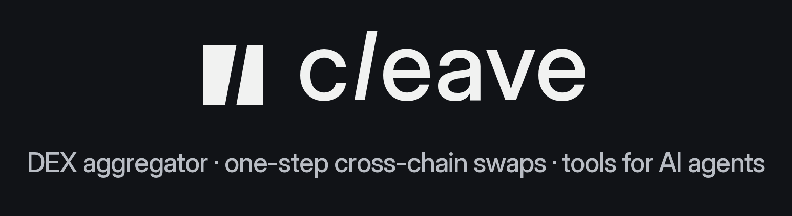

<p align="center">
  
</p>

# Cleave Protocol

Cleave is a DEX aggregator on Ethereum, Arbitrum, Base, BNB Chain, Polygon and Optimism.

- **Many pools, one trade.** Cleave searches many pools and splits a trade over several pools and paths when that pays more, then rejoins the parts in one transaction.
- **One step between chains.** One quote covers the swap out, the move between chains and the swap on arrival.
- **Fees are included in your quote.** Costs that others charge are shown before you sign.
- **Built for AI agents.** Agents get the same quotes through an MCP server, a public API and SDKs. Every plan returns unsigned calls for the user's own wallet.

## Start here

| | |
| --- | --- |
| App | [cleave.fi](https://cleave.fi) |
| Docs | [cleave.fi/docs](https://cleave.fi/docs) |
| For AI agents | [cleave.fi/docs/agents](https://cleave.fi/docs/agents) |
| API | [cleave.fi/docs/api](https://cleave.fi/docs/api) |
| Blog | [cleave.fi/blog](https://cleave.fi/blog) |

## Repositories

| Repository | What it is |
| --- | --- |
| [cleave-swap](https://github.com/cleave-protocol/cleave-swap) | MCP server and agent tools: token swaps, cross-chain swaps and gas top-ups |
| [ai-sdk](https://github.com/cleave-protocol/ai-sdk) | [`@cleave-protocol/ai-sdk`](https://www.npmjs.com/package/@cleave-protocol/ai-sdk): Cleave tools for the Vercel AI SDK |
| [langchain-cleave](https://github.com/cleave-protocol/langchain-cleave) | [`langchain-cleave`](https://pypi.org/project/langchain-cleave/): Cleave tools for LangChain |

## Connect an agent

MCP, no API key:

```sh
claude mcp add --transport http cleave https://api.cleave.fi/mcp
```

SDKs:

```sh
npm install @cleave-protocol/ai-sdk ai zod
pip install -U langchain-cleave
```

## Community

[X](https://x.com/cleaveprotocol) · [Discord](https://discord.gg/uVkmD7JVC2) · [YouTube](https://www.youtube.com/@Cleaveprotocol) · [Blog](https://cleave.fi/blog)

Security reports: info@cleave.fi. Use of Cleave is subject to the [Terms of Use](https://cleave.fi/terms) and the [Privacy Policy](https://cleave.fi/privacy).
